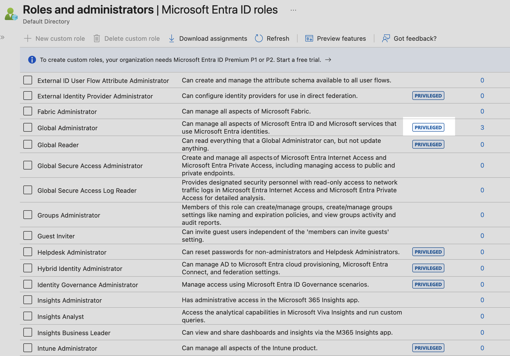
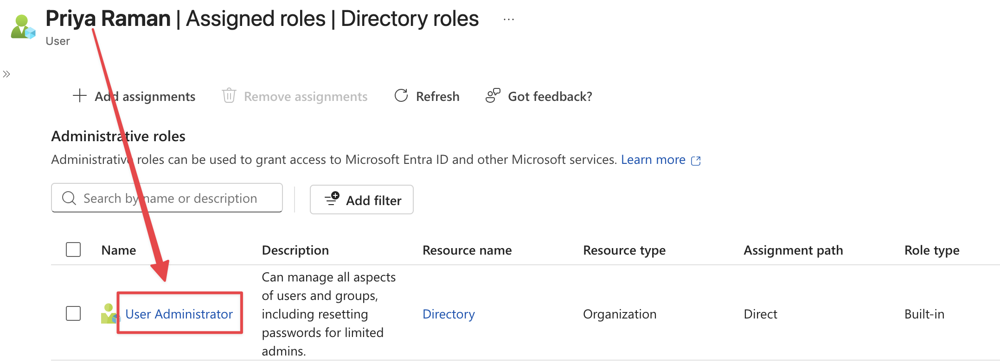
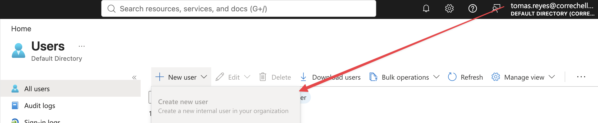
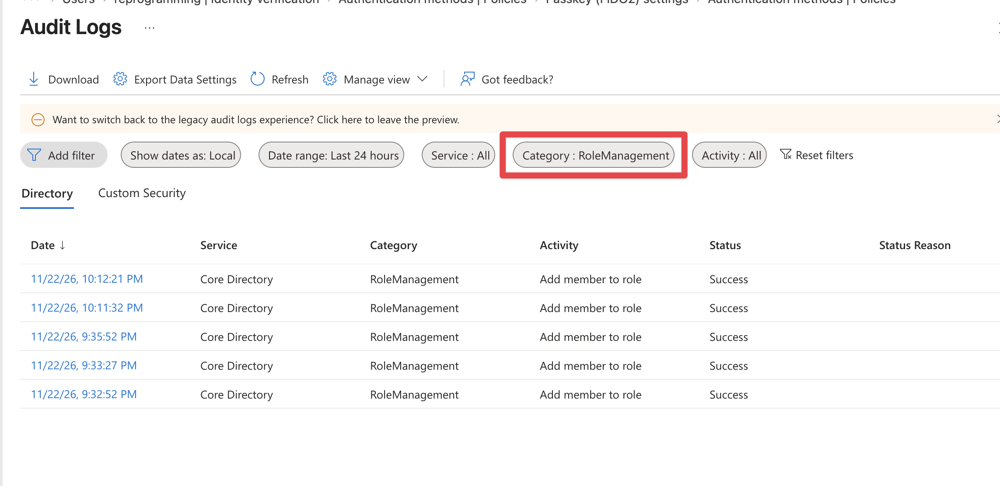

# Principle of Least Privilege at Northwind

## Project Overview
This repository continues the Northwind Services identity management lab started in the [entra-directory-foundation](https://github.com/packet-noir/entra-directory-foundation) repository. It documents decisions and actions related to assigning administrative roles and determining who receives them.

## Business Scenario
IT staff at Northwind need certain permissions to perform their jobs. In this project I assess available built-in roles in Entra's free tier to assign the least privilege role against a given task. 

## Tools Used

Microsoft Entra ID (Free)
Microsoft Learn Docs
Github

## What I Built
Assigned least privilege roles to three IT staff members at Northwind. Created two break-glass accounts. Documented gaps in break-glass account state.

## Screenshots

### Role List

### Assigned Role

### Insufficient Permissions

### Role Assignment Audit Logs

## Security Lessons Learned

## Future Improvements
