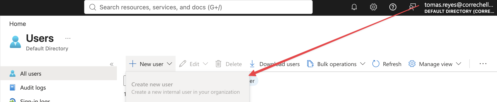

# Role Assignment
|User|Job Title| Requirements | Entra Role Assignment|
|---|---|---|---|
| Tomas Reyes | Helpdesk Technician | Reset standard user passwords | Password Administrator | 
| Priya Raman | Systems Administrator | Create and update user accounts | User Administrator |
| Marcus Chen | IT Manager | Read audit and sign-in logs | Reports Reader |

Assigned roles grant only the privileges necessary to meet the requirements.
Verified against: https://learn.microsoft.com/en-us/entra/identity/role-based-access-control/delegate-by-task

All other users do not require access to M365 administrative environments.

## Future Improvements

Obtain an Entra P1 subscription to assign roles to groups. 

## Global Admin Count

3 (MSFT recommends < 5)

## Privileged Label Role Count

5 (MSFT recommends < 10)

# Permission Boundary

The following screenshot demonstrates Tomas Reyes'inability to create a user given the Password Administrator role.

